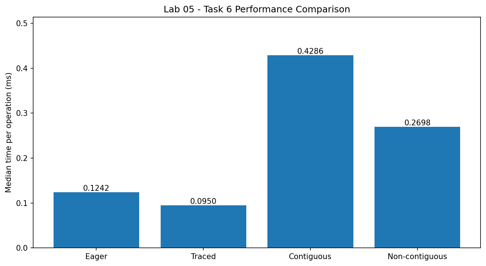

# Lab 05: Frameworks and Automatic Differentiation

## Introduction

This lab explored how automatic differentiation works and how machine learning frameworks execute computations. A custom automatic differentiation engine was developed, verified against PyTorch, and used to train a small neural network. PyTorch execution modes and tensor memory layouts were also investigated.

## Task 1: Value Node

A `Value` class was created to represent nodes in a computation graph. Each node stores its numerical value, gradient, parent nodes, operation, and backward derivative rule.

The implementation was tested successfully using basic numerical values.

## Task 2: Mathematical Operations

Addition, multiplication, powers, and ReLU were implemented to build computation graphs during the forward pass.

For the expression `ReLU((a*b+c)^2)`, with `a=2`, `b=3`, and `c=1`, the output was **49.0**.

## Task 3: Backpropagation

Backpropagation was implemented using topological sorting and the chain rule. Gradients were accumulated using addition rather than overwriting previous contributions.

The calculated gradients were:

- a = 42
- b = 28
- c = 14

A shared-node test using `x*x+x` also passed, producing a gradient of **7** when `x=3`.

## Task 4: Gradient Verification

The custom engine was compared with PyTorch autograd and numerical differentiation using central finite differences.

All three methods produced gradients of **42, 28, and 14**.

The maximum absolute difference was **8.96875 × 10⁻¹⁰**, below the required tolerance of 10⁻⁶. The verification passed.

## Task 5: Neural Network Training

A neural network with a 2–8–1 architecture was trained using the `make_moons` dataset. ReLU was used in the hidden layer, sigmoid at the output, and Binary Cross-Entropy as the loss function.

Both implementations achieved **90% test accuracy**.

Training was repeated five times. The median training times were:

| Implementation | Median time | Accuracy |
|---|---:|---:|
| Custom autograd | 1.8057 s | 90% |
| PyTorch | 3.6529 s | 90% |

The custom engine was faster in this small experiment, likely because PyTorch incurred additional overhead during sample-by-sample training. This does not imply that custom autograd is generally faster than PyTorch.

## Task 6: PyTorch Framework Performance

A small neural network was examined using eager execution and `torch.jit.trace`. The traced computation graph contained linear, ReLU, and sigmoid operations. The traced and eager outputs matched exactly.

After warm-up, the median forward-pass times were:

| Execution mode | Median time |
|---|---:|
| Eager | 0.124248 ms |
| Traced | 0.095000 ms |

Traced execution was approximately **1.308 times faster**.

Tensor properties were also inspected using a contiguous tensor and a non-contiguous transposed view. Both contained identical values.

For the `torch.sin` operation, the contiguous tensor took **0.428609 ms**, while the non-contiguous tensor took **0.269803 ms**.

The non-contiguous tensor was faster in this particular experiment, demonstrating that performance depends on the operation, memory layout, and execution environment.

## Conclusion

This lab demonstrated how computation graphs and automatic differentiation support neural network training. The custom engine produced gradients that matched PyTorch and numerical differentiation within the required tolerance.

The performance experiments also showed that framework overhead, execution mode, and tensor memory layout can influence computation time. The results highlight why performance should be measured rather than assumed.